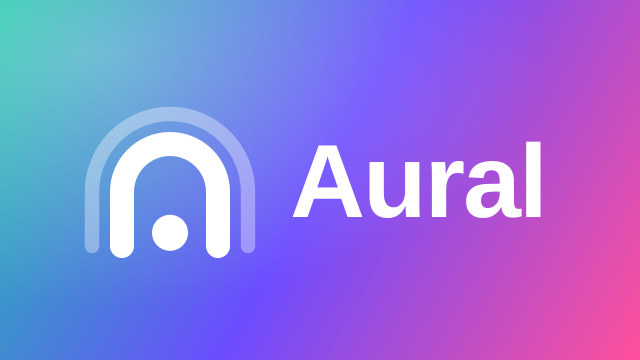
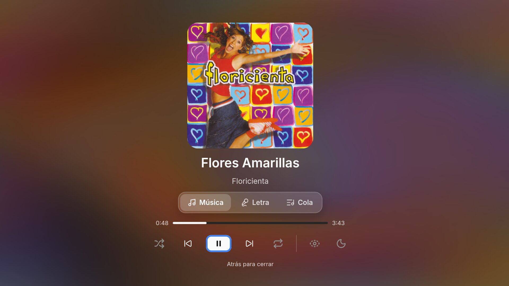
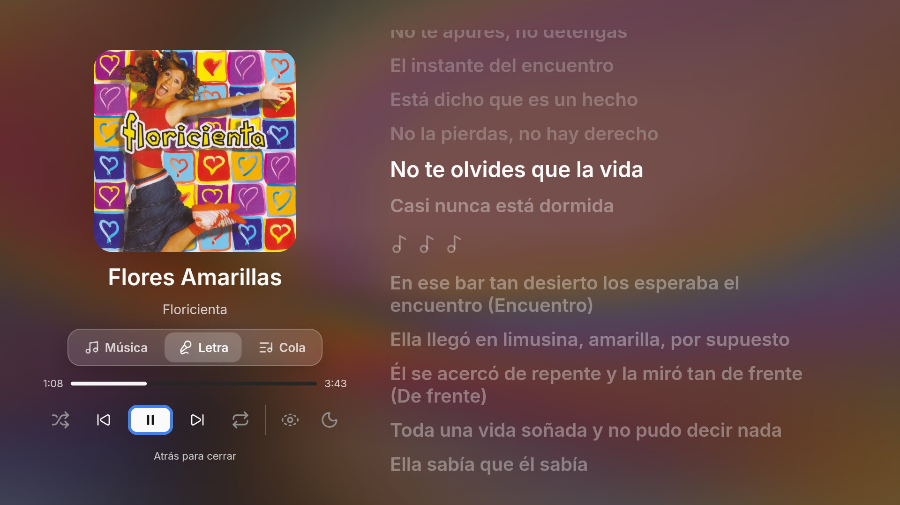
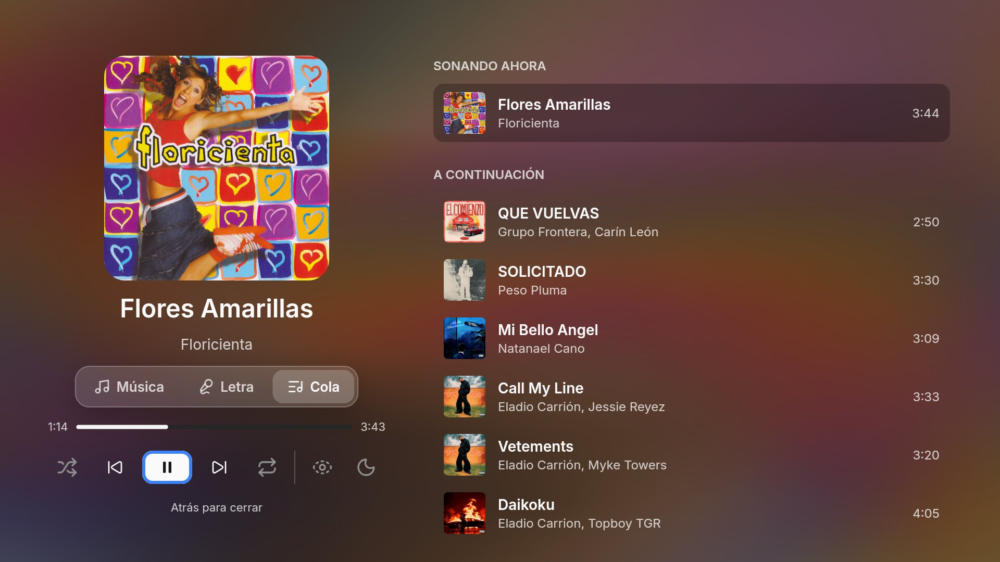
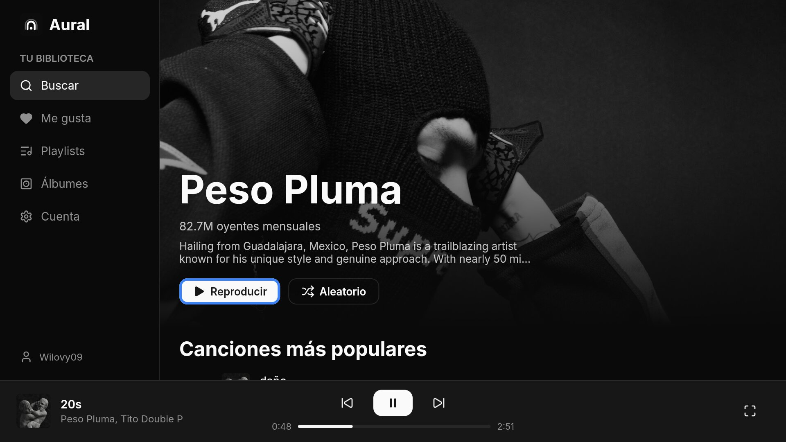
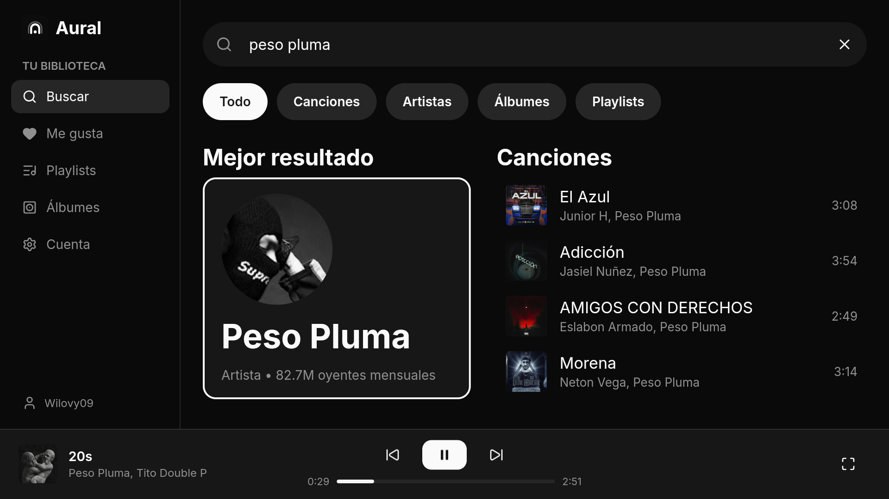
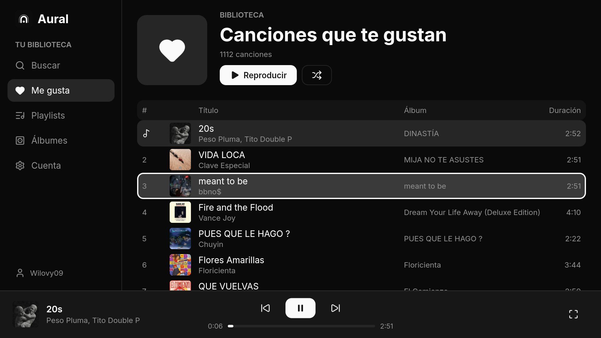
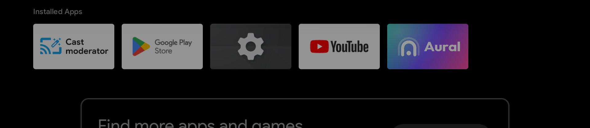

<p align="center">
  
</p>

<p align="center">
  A YouTube Music client for desktop, Android phones and Android TV, written in Rust with <a href="https://freyaui.dev">Freya</a>.
</p>

<p align="center">
  <b>English</b> · <a href="README_ES.md">Español</a>
</p>


## Screenshots

<p align="center">
  
</p>

| | |
| --- | --- |
|  |  |
| Synced lyrics | Queue |
|  |  |
| Artist page | Search |
|  |  |
| Liked songs | Android TV launcher |

## Features

- **Your YouTube Music library**: liked songs, playlists and albums, after signing in with your Google account.
- **Home** with your YouTube Music feed: quick picks and shelves of albums, mixes and playlists.
- **Search** for songs, artists, albums and playlists, with a top result and filters. On desktop it lives in the top bar (⌘K / Ctrl K).
- **Artist pages** in YouTube Music's layout: a banner, monthly audience, top songs, albums, singles, playlists and related artists.
- **Streaming playback** with gapless transitions, loudness normalization, shuffle, repeat and seeking (drag the bar, or left and right on the remote).
- **Synced lyrics**: word by word when available, with duets split by voice. Apple Music lyrics are used first, then LRCLIB, Musixmatch, NetEase, KuGou and YouTube.
- **Likes**: like a song or take the like back from the player, the fullscreen player or a song's row, synced with your YouTube Music account.
- **Queue you can shape**: drag a song by its grip to move it, swipe a song to the left to add it to the queue, and swipe a song in the queue to the left to take it out.
- **Lyrics translation**: each line in Spanish under the original, from Apple Music or Musixmatch's human translations, or a machine translation when there is none.
- **Apple Music covers** across the app, with YouTube's thumbnail as the fallback.
- **Animated album covers** (opt-in), looked up from Apple Music and decoded on the device.
- **Fullscreen player** with an animated backdrop made from the cover, a queue, and clear-screen and night modes.
- **Cover light**: the cover of the song playing gently tints the app.
- **Aural Connect**: play on another Aural on your Wi-Fi and control it from your phone or computer, like Spotify Connect. Paired once with a 4-digit code.
- **Android media controls**: the player in quick settings and on the lock screen, and music that keeps playing in the background.
- **Phone layout** with touch: bottom tabs, a mini player and a portrait fullscreen player.
- **Settings**: your account photo, text size and interface size.
- **Made for the TV remote**: everything works with the D-pad, OK and Back.

## Platforms

| Platform | Status |
| --- | --- |
| Android TV (Android 9+, 32 and 64-bit ARM) | Working |
| Android phones | Working |
| macOS | Working |
| Windows 10/11 | Builds; sign-in uses the WebView2 runtime that ships with Windows |
| Linux | Builds; sign-in needs `webkit2gtk-4.1` (or 4.0) installed |

## Building

You need a recent stable Rust toolchain (edition 2024).

### Desktop

```sh
cargo run --release -p aural
```

### macOS app

```sh
./scripts/macos.sh              # build/macos/Aural.app and build/Aural.dmg
./scripts/macos.sh --universal  # one binary for Apple silicon and Intel
./scripts/macos.sh --install    # also copies Aural.app to /Applications
```

Open `build/Aural.dmg` and drag Aural onto Applications. The app is signed ad hoc, so on another Mac Gatekeeper blocks it the first time: right-click it and choose Open. Set `AURAL_IDENTITY` to a Developer ID Application identity to sign it properly.

### Android

Requirements: the Android SDK with an NDK, build-tools and CMake, JDK 17, and [`cargo-ndk`](https://github.com/bbqsrc/cargo-ndk):

```sh
cargo install cargo-ndk
rustup target add aarch64-linux-android armv7-linux-androideabi
```

Build the APK (no Gradle needed):

```sh
# 64-bit ARM only (default)
./scripts/android.sh

# Universal: 64-bit and 32-bit ARM, for older TVs
./scripts/android.sh arm64-v8a armeabi-v7a
```

The APK is written to `build/aural.apk` and signed with your debug keystore. Install it with `adb install -r build/aural.apk`, or copy it to the device and open it from a file manager.

## Controls

| Key | Action |
| --- | --- |
| Arrows / D-pad | Move |
| Enter / OK | Select |
| Esc / Back | Go back |
| ⌘K / Ctrl K | Search (desktop) |

## Project layout

```
crates/aural    the app: UI, navigation, playback engine, YouTube Music library
crates/lyrics   lyrics search across providers, with word-level timing
crates/motion   animated cover lookup and the Android hardware decoder
crates/webview  native sign-in window for macOS, Windows and Linux
crates/aural/src/connect  Aural Connect: discovery, pairing and remote control
android/        manifest, resources and the Java helpers (sign-in WebView, media session, keep screen on)
scripts/        Android build and packaging
assets/         fonts, icons and logos
```

## Credits

Aural builds on the work of:

- [Sonora](https://github.com/sonorahq): UI, lyrics providers and the desktop sign-in window
- [Artwork API](https://github.com/boidushya/artwork.boidu.dev) for animated covers
- [ytmusic-rs](https://github.com/sonorahq/ytmusic-rs): YouTube Music API
- [kawarp](https://github.com/better-lyrics/kawarp): animated backdrop
- [Freya](https://github.com/marc2332/freya): UI framework
- [Lucide](https://lucide.dev): icons

## Legal notice and DMCA

Aural is an independent, non-commercial, open-source client for desktop, Android, Android TV and iOS, made for personal use, interoperability and study.

- **No copyrighted content is hosted.** Aural does not host, store, stream from its own servers or redistribute any audio, video or other copyrighted media. It has no servers.
- **Client-side interoperability.** Aural is a player that talks to public web services on behalf of the signed-in user, from the user's own device.
- **Trademarks.** YouTube, YouTube Music, Google, Apple Music, Musixmatch, Discord, Android and iOS are trademarks of their respective owners. Aural is not affiliated with, sponsored or endorsed by Google LLC, Alphabet Inc., Apple Inc., Musixmatch S.p.A. or Discord Inc.
- **DMCA.** If you own the copyright to something referenced in this repository, or act for its owner, and believe it infringes your rights, please [open an issue](https://github.com/Wilovy09/aural/issues) or contact the maintainers before taking formal action.

Using Aural is subject to its [Terms of Service](TERMS.md) and [Privacy Policy](PRIVACY.md).

## License

[GPL-3.0-or-later](https://www.gnu.org/licenses/gpl-3.0.html)
